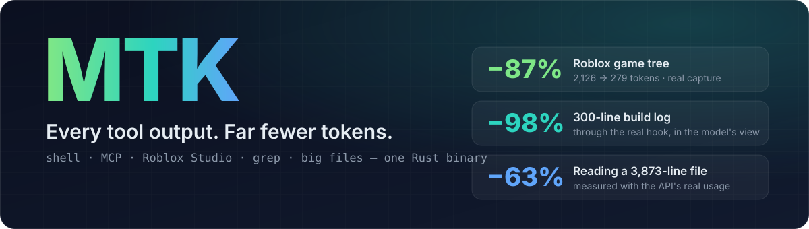
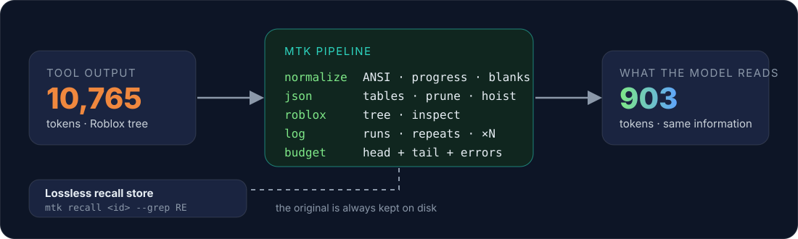

<div align="center">



<br>

[](https://github.com/Polar123321/mtk/actions/workflows/ci.yml)
[](LICENSE)
[](https://www.rust-lang.org)
[](#install-claude-code)
[](#codex-and-any-mcp-client)

**English** · [Português](README.pt-BR.md)

</div>

---

**MTK** is a single Rust binary that shrinks what your AI coding agent *reads* — the output of **shell commands, MCP servers (Roblox Studio included), grep and big files** — before it reaches the model. Same information, far fewer tokens, and the untouched original is always one command away.

```text
   tool output ──▶  MTK  ──▶  model
   10,765 tokens             903 tokens          (real Roblox Studio result)
                    │
                    └── original kept on disk:  mtk recall <id>
```

## See it work

A real `search_game_tree` result from Roblox Studio. The tool returns a flat JSON array where `name` and `parentName` are both derivable from `fullPath`:

<table>
<tr><th>What the tool returned · 2,126 tokens</th><th>What the model reads · 279 tokens</th></tr>
<tr><td>

```json
[{"parentName":"Game","fullPath":"Workspace",
  "name":"Workspace","className":"Workspace"},
 {"parentName":"Workspace",
  "fullPath":"Workspace.OpenWorldMap",
  "name":"OpenWorldMap","className":"Folder"},
 {"parentName":"Workspace",
  "fullPath":"Workspace.TrainMissionSlots",
  "name":"TrainMissionSlots","className":"Folder"},
 {"parentName":"TrainMissionSlots",
  "fullPath":"Workspace.TrainMissionSlots.Slot1",
  "name":"Slot1","className":"Folder"},
 … 36 more nodes like this
```

</td><td>

```text
# name:Class, indent = child
Workspace:Workspace
 OpenWorldMap:Folder
  ParkourRoutes:Folder
  NPCs:Folder
  [Model] Expansion, OpenWorld_City2,
          OpenWorld_City
 TrainMissionSlots:Folder
  [Folder] Slot1, Slot2, Slot3
 TRexForest:Folder
  [Folder] Clearing, Chase1, Ravine, …
 Combat Animations:Model
  Humanoid:Humanoid
  [Part] Torso, HumanoidRootPart, …
```

</td></tr>
</table>

A CI-style build log goes from 300 lines to three:

```text
   Compiling crate1 v0.1.0
… [298 more similar build-progress lines]
   Compiling crate300 v0.300.0
[mtk -98% · full: mtk recall 30a5ee12]
```

## Results

Token counts are MTK's own estimate (alphanumeric runs ≈ 4 chars/token, each punctuation mark 1), so treat the percentages as a guide. The first two rows are **real captures**; the rest are **synthetic** fixtures generated by [`scripts/gen-fixtures.js`](scripts/gen-fixtures.js), which show the mechanism, not your average.

| Fixture | Source | Before | After | Saved |
|---|---|---:|---:|---:|
| Roblox `search_game_tree` | real capture | 2,126 | 279 | **86.9%** |
| Roblox `inspect_instance` | real capture | 644 | 145 | **77.5%** |
| Roblox `get_console_output` · `script_search` | real capture | 254 | 253 | 0.4% |
| npm install log | synthetic | 2,711 | 113 | 95.8% |
| Application log with repeats and one crash | synthetic | 13,140 | 845 | 93.6% |
| `cargo build` with one error | synthetic | 2,160 | 214 | 90.1% |
| GitHub-style issue list (MCP) | synthetic | 19,429 | 2,552 | 86.9% |
| `pytest` with one failure | synthetic | 1,052 | 518 | 50.8% |

Small outputs with nothing redundant are left alone — that is the 0.4% row, and it is the correct behaviour.

### Measured with the API's real `usage`

Headless Claude Code, same task with MTK on and off. This is the API's own token accounting, not an estimate.

| Task | Without MTK | With MTK |
|---|---:|---:|
| Roblox `search_game_tree` (depth 4) — tokens written to cache | 23,823 · 19,372 | **13,771 · 13,455** |
| … cost | $0.061 · $0.052 | **$0.040 · $0.040** |
| "What does `Hir::concat` do?" in a 3,873-line file — tokens written to cache | 40,696 · 36,588 | **14,337 · 14,334** |
| … cost | $0.099 · $0.089 | **$0.041 · $0.041** |

Two runs per side, one task each: consistent, but a demonstration and not a benchmark. The per-session percentage is diluted by the fixed system prompt; the tool results themselves shrink far more. Run `mtk gain` after a few days to see *your* number.

## How it works

<div align="center">

</div>

MTK uses the **`PostToolUse`** hook. Claude Code lets that hook replace a tool's result (`updatedToolOutput`) for *any* tool while keeping its structure, so MTK never rewrites your commands and never breaks quoting, pipes or heredocs.

| Stage | What it does |
|---|---|
| `normalize` | strips ANSI, `\r` progress-bar frames, trailing spaces, blank-line runs |
| `json` | prunes null/empty values, rounds 17-digit floats, renders arrays of objects as tables (`key[N]{cols}:`), hoists constant columns and shared URL prefixes, flattens nested objects, drops REST link noise |
| `roblox-tree` | `search_game_tree` → indented tree |
| `roblox-inspect` | `inspect_instance` → only the non-default properties, plus a count of what was hidden |
| `log` | collapses noise runs (`Compiling…`, `PASS…`, progress), near-identical lines (`… [N more similar]`) and far-apart exact repeats (`[×N]`) |
| `grep` | `path:line:text` regrouped per file, common directory root stated once |
| `budget` | hard token cap (default 4,000): head + tail, with **error and warning lines rescued** from the middle |
| `recall` | the untouched original is stored; the footer tells the model how to fetch it |

### Read guard — read only what is needed

Compressing outputs does nothing about the biggest waste on the input side: reading a 4,000-line file to use 30 lines. A `PreToolUse` hook on `Read` denies the **first** whole-file read of a large source file with an outline, so the agent re-reads just the span it needs. Repeat the same `Read` and it goes through, so legitimate full reads still work.

```text
mtk: hir.rs has 3873 lines (~55286 tokens). Outline (start-end kind name):
213-252 impl Hir
  215-220 fn kind
253-716 impl Hir
  258-278 fn empty
  439-571 fn concat        ◀ the agent reads offset=439 limit=133
  …
```

`mtk outline <file>` prints the same thing. Supported: Rust, Python, Lua/Luau, JS/TS, Go, Markdown, Java/Kotlin/C#/C/C++/Swift (line heuristics, no parser). Files with fewer than 3 symbols — minified, data, logs, JSON — are never guarded.

## Install (Claude Code)

```bash
git clone https://github.com/Polar123321/mtk && cd mtk
cargo install --path .        # puts `mtk` on your PATH

mtk install --dry-run         # shows exactly what would change in ~/.claude/settings.json
mtk install                   # adds the hooks (settings.json is backed up first)
mtk doctor                    # verify
```

Hooks added: `PostToolUse` on `Bash|PowerShell|Grep|WebFetch|mcp__.*` and `PreToolUse` on `Read`. `mtk uninstall` removes only MTK's entries. It coexists with [RTK](https://github.com/rtk-ai/rtk): RTK shrinks command output first, MTK post-processes whatever comes back and covers what a Bash-only hook cannot see.

```bash
mtk gain                      # what you saved so far
mtk recall <id> --grep ERROR  # fetch the original output behind a footer
mtk bench tests/fixtures      # savings table over saved outputs
```

## Codex and any MCP client

Codex's `PostToolUse` cannot rewrite output (per its docs), but MCP servers can be wrapped. `mtk mcp-proxy` is a transparent stdio proxy for any MCP server: it forwards every byte and rewrites only `tools/call` results — never error results, never file-read tools.

```bash
mtk mcp status RobloxStudio    # is [mcp_servers.RobloxStudio] wrapped?
mtk mcp wrap   RobloxStudio    # ~/.codex/config.toml now launches: mtk mcp-proxy -- <original command>
mtk mcp unwrap RobloxStudio    # exact restore (a .mtk.bak copy is written on every change)
```

Tested against the real Roblox Studio MCP server ([`scripts/mcp-e2e.js`](scripts/mcp-e2e.js)): the same 28 tools, small results byte-identical, a real `search_game_tree` result −75.8% in bytes. Restart Codex after wrapping. Shell output inside Codex is **not** covered — that would need `PreToolUse` command rewriting, the fragile approach MTK deliberately avoids.

## MTK and RTK

[RTK](https://github.com/rtk-ai/rtk) is a mature project with 100+ hand-written command filters and support for many agents, and it is excellent at what it does. MTK is not a replacement for that breadth; it attacks a different layer.

| | RTK | MTK |
|---|---|---|
| Mechanism | rewrites the Bash command (`PreToolUse`) | rewrites the *result* (`PostToolUse`) |
| Covers | Bash commands | Bash, PowerShell, Grep, WebFetch, **any MCP tool** |
| Picks a filter by | command name | content type (JSON, tree, log, grep…) |
| Big-file reads | — | outline guard on `Read` |
| Agents | many | Claude Code (hook) · any MCP client (proxy) |
| Command-specific smarts | 100+ filters | a handful (build, test, package-manager noise) |

They stack well: use both.

## Safety

- **Fail open.** Any parse error, panic or doubt produces no output, and Claude Code keeps the original.
- **Never worse.** If the result is not smaller than the input, the input is used.
- **File contents are sacred.** `Read`, `Edit`, `Write`, `Glob`, MCP tools like `read_file` / `script_read` / `get_file…`, and shell commands like `cat` / `head` / `Get-Content` are never rewritten — exact bytes matter for edits.
- **Errors survive truncation.** The budget rescues error and warning lines from the middle.
- **Images and binary blocks** pass through untouched.
- **Nothing is really lost.** `mtk recall` returns the original for 14 days / 500 entries.
- **Tests never touch your data.** 46 tests, including the real Roblox captures, and a check that names and classes survive the tree conversion.

## Configuration

`~/.mtk/config.toml`, everything optional:

```toml
enabled = true
min_tokens = 60             # ignore outputs smaller than this
max_tokens = 4000           # hard budget per output
min_gain_pct = 8.0          # skip rewrites that save less than this
footer = true               # the "[mtk -87% · full: mtk recall <id>]" line
store = true                # keep originals for `mtk recall`
json = true
drop_noise_keys = true      # node_id / *_url noise on REST-style objects
read_guard = true
read_guard_min_lines = 500
float_decimals = 5
exclude_tools = []          # e.g. ["mcp__figma"]
```

`MTK_DISABLE=1` turns it off for one run; `MTK_HOME` moves the data folder.

## Honest limitations

- Token counts are an estimate, not a tokenizer.
- `json`, `log` and `budget` are **lossy by design** (empty values, REST link noise, float digits, collapsed runs). The original is always recoverable, but the model has to decide to ask for it.
- The default-property table behind `roblox-inspect` is small and class-independent; a class whose default differs would show a property as hidden. The output says how many were omitted.
- Verified on Claude Code 2.1.x on Windows. The hook payload shapes (`tool_response`, `updatedToolOutput`) were captured from the real thing; other agents' hooks are not supported.
- CI builds, tests and benches on Linux and Windows (green on the first run); the real-Studio and real-API measurements above were run locally, so they are not part of CI.
- Built-in `Read` and `Glob` results are deliberately not compressed.

## Develop

```bash
cargo test                     # 46 tests
node scripts/gen-fixtures.js   # regenerate the synthetic fixtures
mtk bench tests/fixtures
mtk filter some-output.txt     # see exactly what the model would get
```

Source map: `src/compress/*` (the pipeline), `src/hook.rs` (Claude Code hook + agent-independent `transform`), `src/mcp_proxy.rs`, `src/readguard.rs` + `src/outline.rs`, `src/install.rs`, `src/codex.rs`.

## License

[MIT](LICENSE)
